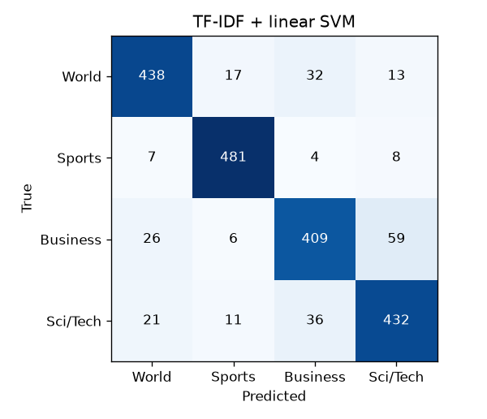
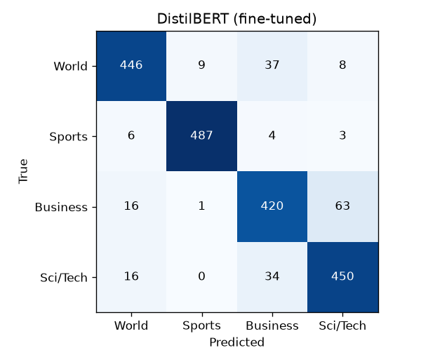
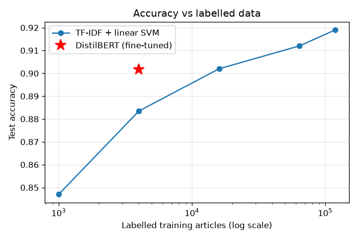

# News Topic Classification: TF-IDF vs DistilBERT


This project classifies news articles into four topics: World, Sports, Business and Sci/Tech. It compares a classical NLP baseline against a fine-tuned transformer on the same data. It then makes the transformer cheaper in two ways, int8 quantization and knowledge distillation, and serves the result through a FastAPI service.

## Problem

Topic tagging is a routine production need, for example routing articles, filtering feeds or tagging content for search. The real question is not which model wins on accuracy. It is what each point of accuracy costs in labelled data, model size and latency. Everything here was trained and measured on a laptop CPU, which is where many such models actually run.

## Dataset

**AG News** has 120,000 training and 7,600 test news articles. Each article is a title plus a description, with 4 balanced classes. The pipeline downloads it from the original CSV release and verifies a SHA-256 checksum on every run.

Preparation:
- **Cleaning.** AG News replaced `&` with a space, so entities appear as ` #39;` and ` quot;`. These are decoded back to `'` and `"`, and stray HTML tags and `\` line breaks are removed. See *Debugging* below for why this mattered.
- **Leakage removal.** 167 duplicate training articles were removed, plus **19 training articles that also appear verbatim in the test set**.
- **CPU budget.** Both models train on the same **stratified 4,000-article subset**. Model selection uses 1,000 held-out training articles. The test set is a stratified 2,000-article subset of the official test split. `--full` uses 20k / 2k / all 7.6k.

## Approach

| | TF-IDF + linear SVM | DistilBERT |
|---|---|---|
| Representation | Sparse word 1–2-grams + character 3–5-grams, sublinear TF-IDF | Contextual subword embeddings, 6 transformer layers, 66M parameters |
| Training | `LinearSVC`, with C chosen on the validation set; sigmoid calibration for probabilities | Hugging Face `Trainer`, AdamW, lr 5e-5, linear warmup and decay, 2 epochs, dynamic padding |
| Selection | Validation macro-F1 over C ∈ {0.03, 0.1, 0.3, 1} | Best epoch by validation macro-F1 |

Then:
1. **Quantization.** PyTorch dynamic int8 quantization of every `nn.Linear` layer, with no calibration data needed.
2. **Distillation.** The fine-tuned DistilBERT acts as a *teacher* and labels 16,000 unlabelled articles. Only predictions with confidence ≥ 0.9 are kept. The fast linear model, the *student*, is retrained on the gold labels plus these teacher labels.
3. **Evaluation.**
   - Accuracy, macro-F1 and per-class F1.
   - A 95% bootstrap confidence interval for accuracy.
   - An exact **McNemar test**, because both models are scored on the same articles.
   - Error analysis by class pair, text length and confidence, plus a manual reading of the most confident mistakes.

## Architecture

```
AG News CSV ──► download + SHA-256 ──► clean ──► dedupe + remove test leakage ──► stratified splits
                                                                                      │
              ┌───────────────────────────────────────────────────────────────────────┤
              ▼                                                                       ▼
   TF-IDF + LinearSVC (calibrated)                                    DistilBERT fine-tune (HF Trainer)
              │                                                                       │
              │                                     ┌──────── int8 dynamic quantization
              │                                     ▼
              │                          teacher labels 16k unlabelled articles
              │                                     │
              └────────► student = TF-IDF + SVM on gold + teacher labels ◄──┘
                                       │
         reports/ (metrics.json, figures, top errors) ◄── evaluate: McNemar, bootstrap CI, error analysis
                                       │
                FastAPI /predict  (NEWSCLF_BACKEND = linear | transformer)
```

```
src/newsclf/
  config.py       typed YAML config (pydantic) with a `full:` override block
  data.py         download, checksum, cleaning, leakage-free stratified splits
  baseline.py     TF-IDF + SVM, C selection, learning curve, top features
  transformer.py  tokenised dataset, Trainer fine-tuning, length-sorted batched inference
  compress.py     int8 quantization, model size, single-request latency
  distill.py      confidence-filtered pseudo-labelling
  evaluate.py     metrics, McNemar, bootstrap CI, plots, error tables
  pipeline.py     the steps: baseline → bert → compress → distill → report
  serve.py        FastAPI service
configs/config.yaml
tests/            22 tests; a tiny random DistilBERT keeps them offline and fast
```

## Results

Test set: 2,000 articles. Both models trained on the same 4,000 labelled articles. CPU: 6 PyTorch threads.

### Accuracy

| Model | Accuracy (95% CI) | Macro-F1 | Train time |
|---|---|---|---|
| TF-IDF + linear SVM | 88.0% (86.6–89.4) | 0.880 | 3 s |
| **DistilBERT, fine-tuned** | **90.2%** (88.8–91.5) | **0.902** | 31 min |

McNemar test: 98 articles only DistilBERT got right, against 55 only the SVM got right, **p = 0.0006**. The 2.2-point gap is real, not noise from a 2,000-article test set.

| Per-class F1 | World | Sports | Business | Sci/Tech |
|---|---|---|---|---|
| TF-IDF + SVM | 0.883 | 0.948 | 0.834 | 0.854 |
| DistilBERT | 0.907 | 0.977 | 0.844 | 0.879 |

<p>


</p>

### How much labelled data is DistilBERT worth?



| Labelled articles for TF-IDF + SVM | 1k | 4k | 16k | 64k | 119k (all) |
|---|---|---|---|---|---|
| Test accuracy | 84.7% | 88.4% | 90.2% | 91.2% | 91.9% |

DistilBERT trained on 4k labels (90.2%) matches the linear model trained on **16k** labels. Pre-training is worth roughly a 4× labelling budget here. With the full 119k labels, the 3-second linear model reaches 91.9%. When labels are cheap and plentiful, the transformer's advantage on this task shrinks.

*(The 4k point, 88.4%, is the uncalibrated SVM. The calibrated model used everywhere else scores 88.0%.)*

### Compression: quantization and distillation

| Model | Accuracy | Size | Latency, 1 article (p50 / p95) | Throughput, batches of 64 |
|---|---|---|---|---|
| DistilBERT fp32 | 90.2% | 268 MB | 63 / 82 ms | 19 articles/s |
| DistilBERT **int8** | 89.7% | **139 MB** (−48%) | 75 / 90 ms | **33 articles/s** (1.7×) |
| TF-IDF + SVM | 88.0% | 10 MB | 11 / 16 ms | — |
| **Distilled student** (TF-IDF + SVM) | **89.4%** | 23 MB | 11 / 16 ms | — |

- **Quantization** halves the model and makes batched inference 1.7× faster, at a cost of 0.45 points of accuracy. The int8 model agrees with fp32 on 98.1% of articles. For a single article it is *not* faster: at batch size 1 the cost is dominated by tokenisation, Python overhead and attention, not by the int8 matrix multiplies. Quantization pays off for batch and offline workloads.
- **Distillation** gives the cheap model **+1.4 points** (88.0% → 89.4%, McNemar p = 0.003) at the same 11 ms latency.
  - The teacher's labels were 90.0% correct overall and **96.9% correct** after the 0.9 confidence filter, which kept 11,096 of 16,000 articles.
  - A control experiment trains on the same 16k articles with their *true* labels and reaches 90.7%. That is the most this extra data could give.
  - Distillation recovers 52% of that headroom using **zero** extra human labels.
  - The student is larger on disk (23 MB) because its vocabulary grows with the extra articles.

Timings were measured on a laptop and varied by about ±30% between runs; compare ratios, not absolute values.

## How to run

```bash
python -m venv .venv && source .venv/bin/activate   # Windows: .venv\Scripts\activate
make install            # pinned deps (CPU PyTorch) + package
make test               # 22 tests, about 10 s, no downloads
make all                # full pipeline, about 50 min on a laptop CPU (DistilBERT fine-tune is 31 min)
python -m newsclf bert  # or run one step: baseline | bert | compress | distill | report
make full               # 20k training articles + full test set (hours on CPU)
```

Outputs:
- `reports/metrics.json` holds every number in this README.
- `reports/figures/` holds the plots.
- `reports/top_confident_errors.csv` holds the most confident mistakes.
- `artifacts/` holds the trained models.

Serve:

```bash
make serve                                     # distilled linear student (default)
NEWSCLF_BACKEND=transformer make serve         # int8 DistilBERT
curl -X POST localhost:8000/predict -H "Content-Type: application/json" \
     -d '{"texts": ["Oil prices climb as OPEC agrees to cut output"]}'
```

```json
{"backend": "linear", "predictions": [{"label": "Business", "confidence": 0.9952, "probabilities": {"World": 0.0001, "Sports": 0.0014, "Business": 0.9952, "Sci/Tech": 0.0033}}]}
```

The service validates its input: 1–64 non-empty texts per request, otherwise it returns 422. It applies the same text cleaning as training. Docker: `make all && make docker`.

## Error analysis and root causes

**1. Business vs Sci/Tech is the main failure mode for both models.** Business articles predicted as Sci/Tech are the largest error cell: 63 for DistilBERT, 59 for the SVM. Examples include "IBM posts Q3 revenue growth", "Lockheed profit jumps on IT demand" and "Google rumoured to build a browser". Technology-company earnings are *both* topics, and the dataset's single label is a judgement call. Sports, a distinct vocabulary, is near-perfect for both models (F1 0.95–0.98).

**2. Many confident "errors" are label noise, not model mistakes.**
- Both models were wrong on 142 articles, and on **127 of them (89%) they agreed on the same wrong label**. Two models with completely different representations rarely make the same mistake unless the gold label is questionable.
- Reading DistilBERT's 12 most confident errors (all ≥ 96.8% confidence), most look mislabelled:

| Gold label | Predicted | Article |
|---|---|---|
| Sci/Tech | World | "Bush Scraps Most U.S. Sanctions on Libya (Reuters)…" |
| Sports | World | "Judge Clears Release of Kobe Evidence (AP)…" (a criminal case) |
| Business | World | "Audit finds no fraud in Venezuelan recall vote…" |
| Business | Sports | "Brewers buyer expected to step out of the shadows…" |

  - Label noise caps achievable accuracy below 100%. Treating these as model failures would mean tuning to noise. The right next step is relabelling, not a bigger model.

**3. The transformer helps most on short texts.**

| Words in article | ≤25 | 26–35 | 36–45 | >45 |
|---|---|---|---|---|
| SVM error | 17.8% | 13.2% | 10.9% | 9.1% |
| DistilBERT error | 15.3% | 10.1% | 9.1% | 8.5% |

- With few words there are few n-grams for TF-IDF to match, and any word unseen in the 4k training articles contributes nothing.
- DistilBERT brings word meaning from pre-training, so it can use words it never saw in a labelled example.
- On long articles both models have enough evidence and the gap closes to 0.6 points.

**4. The linear model's top features show the shortcut it learns.**
- World's strongest features include `afp`, `canadian press` and `afp afp`. These are **news-agency names, not topic words**. Wire services happen to correlate with international news in this dataset.
- This works on AG News but would break on articles from a different source mix.
- A production version should strip agency bylines before training.

## Debugging notes

- **HTML entities hid inside the text.**
  - The first cleaner decoded ` #39;` but not ` quot;`/` amp;`. Reading the most confident errors showed `"…said it quot;hoped…"` in the text, which led to a scan that found leftover entities in **5.2% of articles**.
  - After the fix, rerunning everything raised the TF-IDF baseline from **86.9% to 88.0%**, while DistilBERT stayed at 90.15%.
  - The bag-of-words model had learned `quot` and `amp` as features. The subword model treated them as noise. A regression test now pins this.
- **A tokenizer that only produced `[UNK]`.**
  - The fine-tuning unit test showed loss stuck at exactly ln 4 = 1.386 (uniform guessing).
  - Root cause: in transformers 5, `DistilBertTokenizerFast(vocab_file=…)` silently ignores the file and needs `vocab=dict` instead. Every token was `[UNK]`, so there was nothing to learn.
  - A dedicated test now asserts that the test tokenizer knows its own vocabulary.
- **API changes in transformers 5.** `warmup_ratio` was removed; `warmup_steps` now accepts a fraction of total steps.
- **Windows Smart App Control blocked `pyarrow`'s DLLs**, which broke the `datasets` library. The project reads the original CSVs directly, which also removed a heavy dependency.
- **The baseline's best C was on the edge of the search grid** (0.1 in {0.1…3}), which means the true optimum might lie outside it. The grid was extended to 0.03. On the cleaned data the best C is 1.0, inside the grid.

## What I learned

- **Measure what accuracy costs, not just accuracy.**
  - DistilBERT's 2.2-point gain is real (p < 0.001) but costs 25× the size, 6× the latency and 600× the training time.
  - Distillation recovered 1.4 of those points for free at inference time, and that is often the model I would actually ship.
- **Pre-training is a substitute for labels.** The learning curve turns "transformers are better" into a number: worth about 12k extra labelled articles on this task.
- **Read the errors.** The two biggest findings, the entity bug and the label noise, came from reading the misclassified articles, not from the metrics.
- **Quantization is workload-dependent.** int8 halved the model and sped up batches but did nothing for single requests on this CPU, so benchmark the latency pattern you actually serve.
- **Use a paired test when comparing models on one test set.** McNemar uses the per-article disagreement that a simple accuracy difference ignores.

## License

MIT
